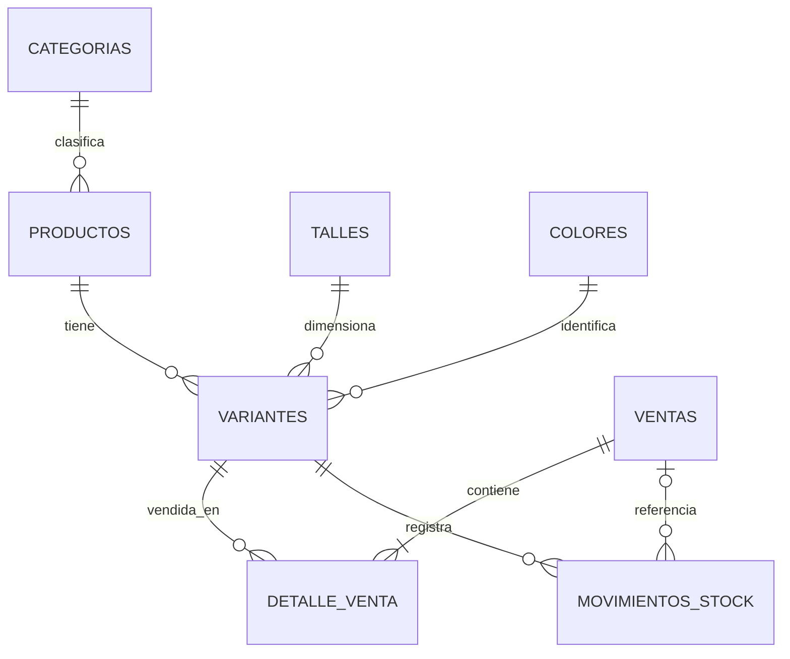

# Modelo entidad-relación y esquema relacional

## Cardinalidades y decisiones
- Una categoría puede clasificar muchos productos; cada producto tiene una categoría.
- Un producto puede tener cero o muchas variantes; cada variante tiene exactamente un talle y un color.
- La combinación producto/talle/color no se repite. El código de variante también es único.
- Una venta contiene una o más líneas de detalle. Cada línea conserva cantidad, precio unitario aplicado y subtotal históricos.
- Una variante puede aparecer en muchas líneas de venta y movimientos de stock. Un movimiento puede referenciar una venta o ser independiente.
- Las claves foráneas usan `ON DELETE RESTRICT` para no destruir historia. Se desactivan productos, no se borran físicamente.
- El precio vive en `productos` y es común a todas sus variantes. `detalle_venta.precio_unitario` conserva el precio aplicado en el momento de la venta.
- `ventas.medio_pago` representa un medio principal. Para pagos mixtos se debe acordar una tabla `pagos_venta` con el módulo de ventas antes de ampliar el alcance.

## Esquema relacional
- `categorias(id PK, nombre UNIQUE)`
- `productos(id PK, nombre, descripcion, categoria_id FK, precio, activo, creado_en, actualizado_en)`
- `talles(id PK, nombre UNIQUE)` y `colores(id PK, nombre UNIQUE)`
- `variantes(id PK, producto_id FK, talle_id FK, color_id FK, codigo UNIQUE, stock_actual, stock_minimo, UNIQUE(producto_id,talle_id,color_id))`
- `ventas(id PK, fecha_hora, total, medio_pago, estado, motivo_anulacion)`
- `detalle_venta(id PK, venta_id FK, variante_id FK, cantidad, precio_unitario, subtotal)`
- `movimientos_stock(id PK, variante_id FK, tipo, cantidad, fecha_hora, motivo, venta_id FK nullable)`
